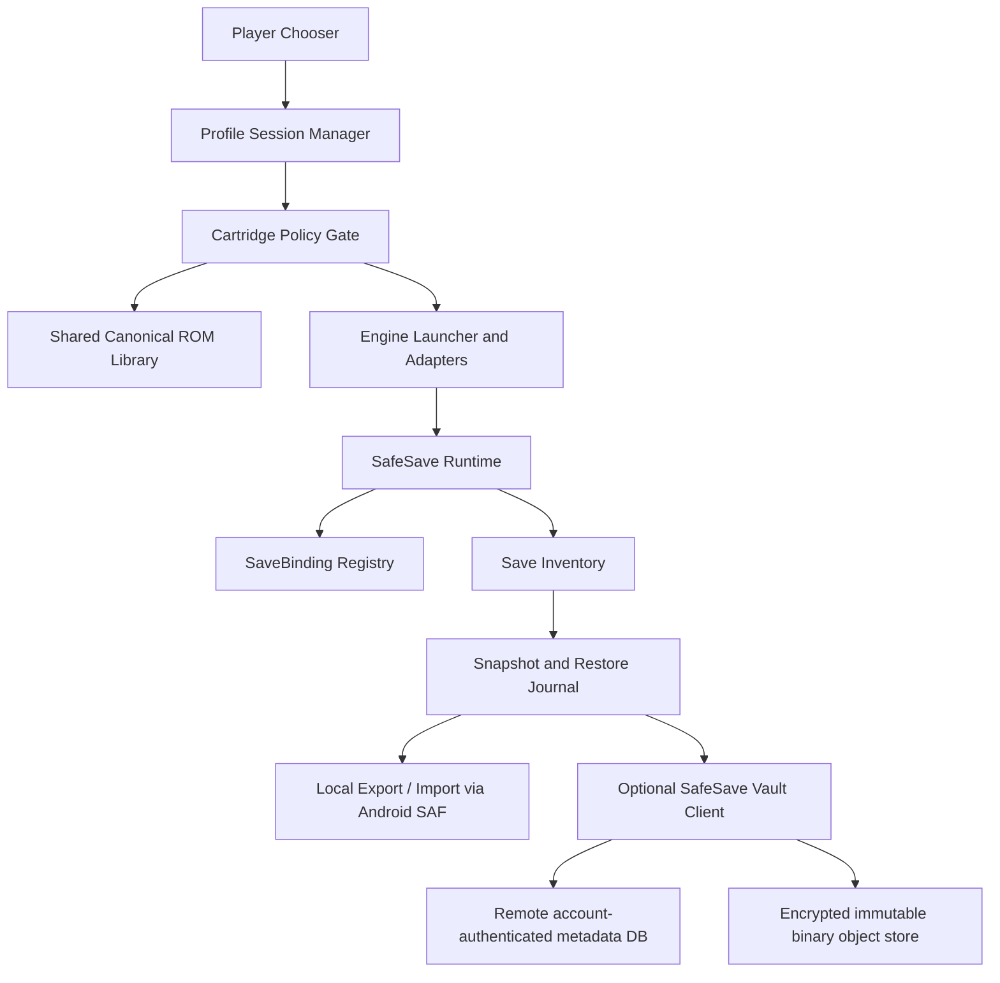
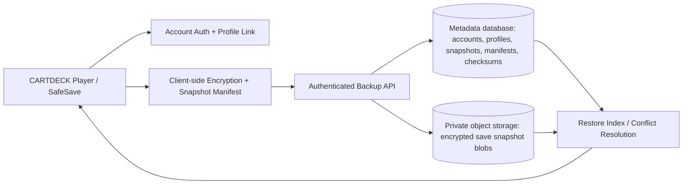

# CARTDECK — Daniel Mercer: Universal Profiles, Junior Restrictions and SafeSave Architecture
**Design baseline:** v1.0 — 2026-11-16 (AEDT)  
**Status:** Architecture proposed/recorded; product-design direction already approved; implementation and device verification not authorised.  
**Related:** JR-01 #288, PROF-01 #289, SAVE-01/02 #290, ARCH-LIB-01 #145 / PR #201 / PR #206; design `docs/design/jr01/JR01_PRODUCT_UX_SPEC.md` (Amendment 1).  
**Protected:** GC-01/CI-01 active lane, all existing ROM/library functionality, legacy progress, native engines, app signing/package, rollback and Room migrations. Do not code in GC lane.

## 1. Product model and invariants
- CARTDECK **installation** hosts a single canonical ROM library, installed engines and a set of local player profiles. Support >=3 players but no artificial fixed limit. No user login required for local play.
- Profile types: `MANAGER` (admin permission), `STANDARD` (all ROMs visible by default; per-profile hidden list), `JUNIOR` (explicit canonical cartridge-ID allowlist, **default deny** for newly imported/unrated games).
- Manager is a capability, not necessarily every adult/standard profile. Each player owns favourites, collection membership/order, theme, recent titles, controller preferences where supported, and **all their saved progress**.
- Junior's front-end is **one cartridge at a time** (touch swipe; controller D-pad), no multi-cover shelf; all launches pass through policy guard, including deep links, auto-resume and native core invocation. Switching away from Junior to unrestricted profiles requires parent authentication.
- Global ROM catalog and canonical cartridge IDs remain stable; no ROM duplication or unintended file moves, no new mandatory backend connection.
- SafeSave is the **local save inventory, ownership and portability service** that all emulators/adapters use. An opt-in remote feature named **SafeSave Vault** could later store saves only, no ROMs/BIOS/firmware/game packages.
- Local player ID != cloud account ID; mapping must be explicit, revocable and safe for offline usage. No child email required.

## 2. Current source constraints recovered from ARCH-LIB-01
Checkpoint A added Room v12 cartridge UUIDs, frozen `legacyFileName`/`legacySourceUri` aliases and surfaced save write errors; existing stores are heterogeneous: filename-based SRAM/state, DS (.sav/.dsv) conversion, PCSX/PSP native paths, memory cards, engine-scoped persistent dirs and virtual HDDs. Checkpoint B proposed additive collision-safe SaveBinding and atomic copy-verify-activate; do NOT treat all native-engine persistent-store migration or cross-device restore as already proven.
Historical duplicate-filename saves can be ambiguous. Do not guess by name/title/hash or silently assign to a child. Frozen legacy aliases remain read-compatible. A Room downgrade v12→v11 is unsafe without a validated complete snapshot, and WAL/sidecar data matters to DB recovery.

## 3. Logical component architecture

**Access boundary:** all data-layer, launcher and resume entrypoints enforce `profileId + policy`; UI hiding is insufficient. **Storage boundary:** local ROM library never depends on remote sync, and remote store never receives ROM images.

## 4. Local data model — versioned additive migration only
These are *conceptual* entities, not directives to alter current Room schema immediately:
- `PlayerProfile(profileId UUID PK, displayName, profileType, avatarRef, themeId, createdAt, isArchived)`
- `ProfileCapability(profileId, capability, grantedByManagerId, updatedAt)`
- `ProfileCartridgePolicy(profileId, cartridgeId UUID, state [ALLOW|HIDE], updatedAt)` — no entry = ALLOW for STANDARD, DENY for JUNIOR.
- `ProfileCollection(profileId, collectionId UUID, name, order, theme)`; `CollectionItem(collectionId, cartridgeId, sortIndex)`.
- `SaveArtifact(artifactId UUID, ownerProfileId nullable, cartridgeId nullable, platformId, engineId, engineVersion, saveType, saveScope, sharedGroupId nullable, slotId nullable, internalLocationRef, lastHash, sizeBytes, compatibilityState, lastVerifiedAt)`.
- `SaveBinding(profileId, cartridgeId?, engineId, artifactId, legacyAliasRef?, state)` — bindings for engine-scoped and shared memory cards do not require a one-to-one cartridge foreign key.
- `SaveSnapshot(snapshotId UUID, profileId or manager-scope, createdAt, schemaVersion, consistencyStatus, manifestHash, originDeviceId, exportStatus)`; `SnapshotArtifact(snapshotId, artifactId, contentHash, relativePath, size)`.
- `SaveOperationJournal(opId UUID, kind, stage, actorId, profileId, snapshotId, stagedLocation, resultCode, timestamps)`.
- Future `CloudAccountLink(localProfileId, remoteAccountSubject, recoveryKeyStatus, consentState)` and `RemoteSnapshotRef` stored separately from local save content.
- **LegacyUnknownArtifact** quarantine list for files whose ownership cannot be determined safely; include in manager export under clearly marked `UNASSIGNED` provenance but never auto-load for Junior.
- Retain original Room IDs, cartridge UUIDs, legacy aliases and old read paths; migration to profile-owned data must be `COPY → HASH VERIFY → REGISTER → ACTIVATE`. Never rename/delete original as part of migration. Backup full DB and WAL-consistent snapshot before schema changes.

## 5. Save coverage: full save inventory, not merely emulator states
**SAVE ALL** means every *detected and successfully snapshotted supported save artifact* across all installed engine adapters for the selected profile(s), including:
1. GB/GBC/GBA SRAM, flash, EEPROM/battery formats and relevant metadata.
2. DS `.sav`, `.dsv` and emulator-specific native save directories.
3. Emulator save states: manual, automatic, quick-resume, previews/metadata if needed to recover state; record exact core/engine version and compatibility.
4. PS1 memory cards (shared or per-game), PS2 memory-card containers and index/slot metadata when engine adapter exposes them safely.
5. PSP `SAVEDATA` directories, companion metadata and engine saves; PS3 game savedata directory graphs where engine exposes them, not installed game content or trophy/account licensing assumptions.
6. Dreamcast VMUs/memory cards, GameCube memory-card images, Wii save containers and Xbox saves, via audited platform/engine adapters.
7. Engine-scoped card banks, per-profile persistent save areas, auxiliary checksum files and any essential sidecar, even when not attributable to a single game.

**Coverage contract:** `SUPPORTED_VERIFIED`, `DETECTED_UNVERIFIED`, `UNAVAILABLE_LOCKED`, `POSSIBLE_MIXED_CONTENT`, `UNSUPPORTED`, `UNASSIGNED_LEGACY`. Show detected/covered/skipped counts by console before calling an export complete. Never claim “all saves protected” if any adapter is unavailable, active/unflushed, or content uncertain.

**Mixed-content rule:** some Wii/NAND or Xbox virtual-HDD files may include installed game binaries, titles, firmware or other non-save content. Do not blindly export/upload a complete opaque virtual disk as “saves only.” Extract audited save-only containers when feasible; otherwise mark `POSSIBLE_MIXED_CONTENT` and exclude from save-only remote backup, with visible disclosure. Entire raw persistent-store archive, if ever offered as a separate *local engine backup*, needs explicit product/legal/privacy review, and must not be silently reclassified as SafeSave.

## 6. Engine adapter contract
Each platform/engine adapter implements:
`discover(profileId): ArtifactInventory`
`quiesce(session, profileId): SaveFlushResult` (pause/flush or require engine closed; never copy actively mutating cards)
`snapshot(artifactSet, stagingDir): SnapshotResult` (copy complete files/directory trees, preserve metadata, hashes)
`validateImport(manifest, target, engineCapabilities): CompatibilityReport`
`restore(snapshot, destinationBinding, conflictPolicy): OperationResult`
`resumeRecover(journal): RecoveryResult`
No hard-coded assumption every engine uses standard `.srm` or has portable save states. Unknown engine/file version is `UNSUPPORTED` until verified. Only adapters with passing synthetic and device evidence report `SUPPORTED_VERIFIED`. Stage adapter by console rather than a monolithic filesystem crawler.

## 7. SafeSave local workflows
### Export one, player, or everyone
- Entry: `SafeSave → Export → Game / Player / All Players (manager)`; show each console's coverage, artifact sizes, active-game warning and skipped items.
- Snapshot should start only after game session quiescence; if that is not possible, require exit and retry. Resolve engine-scoped shared cards by profile scope, not by game title.
- Create immutable staged snapshot including manifest and checksum list, then use Android Storage Access Framework `ACTION_CREATE_DOCUMENT` or authorised folder destination. A portable `.cartsave` (versioned ZIP-like container) carries structured manifest, save data, sidecars and optional encryption. **No ROMs, game executables, BIOS, firmware, device keys or personal account tokens.**
- Manager-wide export: each profile's namespace plus any explicitly unassigned legacy files in a quarantine section. Respect permissions and explicit disclosure. Writing to SAF may be partial: verify final destination length/checksum if provider supports readback; do not announce success until finalised or explain provider limitation and retain staged file for retry.
- Explicit options: whole player's saves, all players, one game's saves, memory-card artifact; include original engine metadata for future import. Optional password-encrypted archive to protect shared-device exports.

### Import / restore
- Select archive via SAF `ACTION_OPEN_DOCUMENT`, never unrestricted arbitrary filesystem traversal. Parse in limited staging with path traversal/zip bomb/symlink/size limits, version/signature and checksum validation.
- Preview source profile, game/platform identity, engine requirements, contents by save type and memory cards, targets, byte sizes, `compatible / needs mapping / unavailable`. Never map solely by filename/title.
- Conflict choices: `Skip`, `Restore as extra slot` **only where engine supports**, or `Replace with backup` after manager/owner confirmation. A restore into another player is explicitly copy semantics.
- Create recovery snapshot of destination, write into staging, verify hashes, activate atomically per supported group, journal commit, clean only after success; on failure rollback target to pre-restore version. Across multiple engines/cards report per-group success/failure and avoid declaring fully atomic whole-device restore unless implemented.
- Import absent ROM: allow archival orphan-save inventory and later manual re-link to exact cartridge; never auto-fetch ROM or use fuzzy content names to overwrite.

### Between-profile copy
- Manager/authorised source chooses game or card, chooses target player, previews collision, **copies** immutable snapshot; original remains unchanged, source and target never share mutable storage path. Junior cannot export another player's data.
- Switching player while a game runs requires safe flush/close before new profile attaches an engine's save path, including global memory cards and native virtual storage.
- Deleting a local profile first offers `Export first` / `Archive locally` / `Delete with explicit confirmation`; child cannot delete, no ROM deletion.

## 8. SafeSave Vault: optional saves-only cloud design, not now an implementation
**Decision:** a *database alone* is not the recommended store for binary memory cards/savestates. Use an authenticated database for metadata/ownership and encrypted object/blob storage for snapshots. This also handles large engine-specific save directories.

Remote metadata tables (concept): `users`, `linked_profiles`, `backup_sets`, `backup_objects`, `backup_versions`, `restore_audit`, `recovery_credentials`. Stable remote account subject scoped; internal IDs opaque. Enforce row-level/scoped authorization and time-limited object access tokens. Junior storage managed by authenticated parent; no child account required.
- Vault allowed bytes: save snapshot archive content and minimum safe manifest metadata only. **Never** upload ROMs, BIOS, firmware, installed game binaries, thumbnails/screenshots unless separately explicitly approved, app logs, passwords, or controller secrets. Prefer no game cover/title leakage in plaintext metadata.
- Opt-in per-profile `Connect SafeSave Vault`; first iteration **manual Upload Saves / Download Backup**. No background sync or automatic upload until explicitly designed and accepted. Offline gameplay and local export remain usable forever.
- Encrypt snapshot client-side with authenticated encryption; use a deliberate **cross-device key recovery design** (account-protected recovery secret or user recovery key); Android device-only Keystore keys alone cannot recover on a replacement device. Authenticate accounts and manage credentials through secure flows, use TLS and protected private buckets. Account reset + lost recovery key means encrypted backups may be unrecoverable; disclose clearly.
- Use immutable versioned snapshots, per-profile retention, quotas, device labels, restore preview, conflict handling, audit trail and deletion semantics. Design concurrent-device writes without last-write-wins overwrites.
- Account link != profile ownership change. Link/revoke/relink and account deletion must not delete local playable saves without separate consent. Upload or restore across accounts requires verified owner permission.
- **No cloud claims** until separately authorised backend choice, privacy/data-retention policy, security/threat review, cost/capacity planning, live restore and cross-device tests.

## 9. Junior security threat model
1. **Authorization at data boundary:** cartridges policy guard at UI, DAO queries and launcher for all routes (including resume, shortcuts, menu, controller and external intents).
2. **Profile guard:** locked Junior → unrestricted/manager mode always parent auth. PIN stored securely as verifier with rate-limits, OS-backed option and verified parent recovery; no in-app visible bypass. OS-level exit/outside app is not a kiosk guarantee.
3. **Save guard:** ownerProfileId drives open/save/restore, and engine persistent dirs are rebound before launch. No leaked adult cards through shared native emulator defaults. Child cannot browse filesystem/export/import/connect cloud. Parents can manage Junior backups.
4. **Identity guard:** game ID migration/ROM reimport never silently changes owner or assigns legacy collisions; lost binding fails safe and prompts manager resolution.
5. **Data guard:** both local and exported backups are sensitive; encrypted exports optional/encouraged, remote mandatory; no path/filename or personal info in logs.

## 10. Edge cases and operational rules
- Crash/low storage while snapshotting: staging journal resumes or invalidates, originals never mutated. Remote upload retry must be idempotent and server objects garbage-collected only after retention.
- Memory card shared across games: belongs to profile + platform engine bank, includes references to multiple cartridges, never split naively.
- Two users same game: distinct save bindings despite same ROM and engine. If engine cannot isolate its internal storage, block profile switching while active or mark engine not multi-profile-ready.
- Native/experimental cores with unverified persistent location: do not declare complete backup. Record exclusions and require adapter engineering.
- ROM moved/re-imported: preserve immutable cartridge identity when verified; pending manual mapping if ambiguous, never bind to another game based on display name.
- Wrong profile import or age restriction: manager authorisation and explicit confirmation, no silent grant of ROM access by importing a save.
- Existing v12 saves and rollback: archive verified originals, preserve frozen aliases, avoid destructive Room fallback; a downgraded APK may not read new schema.
- Unknown legacy cards: quarantine and manager-only resolution/export; never auto-share to Junior.
- Uninstalled app: local app-private data can be lost; explicit external export recommended. Don't assume Android Auto Backup includes complete native saves.

## 11. Release increments and gates (after active GC-01 / CI-01)
**A: Design/Readiness** — engine-by-engine persistent artifact inventory; architecture threat model; migration and rollback review. No code.
**B: PROF-01** — additive local multi-player identities + standard hide policy and Junior allowlist enforcement, baseline install-over migration. Regression gate.
**C: SAVE-01** — owner-specific SaveBindings (SRAM/states + engine-adapter persistent stores), active-session quiescence and legacy protection. Regression gate.
**D: SAVE-02 SafeSave local** — inventory, complete-coverage reporting, export/import/restore/cross-profile copy, recovery journal. Separate engine adapters incremental with explicit supported list; no claiming all-save success before every engine is audited.
**E: JR-01** — one-cartridge Playroom + protected parents area using completed profiles/ownership. Child UX test on portrait, landscape, tablet, TV.
**F: SAVE-03 Vault investigation** — backend provider choice, security/privacy/quotas/consent, separate approval; build optional manual cloud snapshots only after local SafeSave proves trustworthy.
These are dependency groups, not an instruction to interrupt or reorder active GC-01/CI-01 work.

## 12. Independent Marcus QA acceptance
- Install-over of existing real save data and app settings; no uninstall/clear data. Existing adult saves preserved byte-for-byte or with proven non-lossy migration.
- Three concurrent player profiles, distinct visibility, all save types for same ROM, independent game histories and theme; verify adult/Junior isolation and parent gate bypass attempts.
- Every supported core tested: SRAM, native save, memory card/VMU/NAND-backed save where applicable, savestates, in-game exit, session switch, emulator upgrade, backup and restore.
- Export all players => manifest includes supported memory cards/shared banks and explicit enumeration of skipped/unknown items. Exercise SAF external/local provider, empty storage and revoked grant.
- Valid archive roundtrip, incompatible core, wrong ROM, corrupt archive/zip bomb, duplicate slot, interrupted restore, low disk, downgrade/roll-forward, cloud offline, two-device overwrite conflicts.
- Confirm missing/skipped items surfaced and never declared 100% backed up. No ROM or mixed-content virtual drive included in remote vault.
- Only after owner physical evidence may coverage be marked PASS; synthetic tests alone don't prove native engine device paths.

## 13. Decision register
- LOCKED: CARTDECK universal local profiles; manager/standard/Junior policy; one-cartridge Junior carousel; separate save ownership; all-detected-save and memory-card export as target; archive import/copy; offline first; no ROMs in backups; eventual saves-only Vault as optional.
- ARCHITECTURE DEFAULT: `.cartsave` versioned container; local Room index + file-backed payloads; remote SQL metadata + encrypted object blobs; explicit manual first upload/download; no account sign-in required for local use.
- STILL REQUIRES IMPLEMENTATION AUDIT: exact engine save directories, virtual-store separation, version compatibility, legacy ownership ambiguities, safe engine flush/close, migration impact and rollback proof.
- DEFERRED OWNER DECISIONS: remote backend/provider and pricing/quota, opt-in auto backup scheduling, cloud encryption recovery UX and retention policy. None block JR-01 local design.
