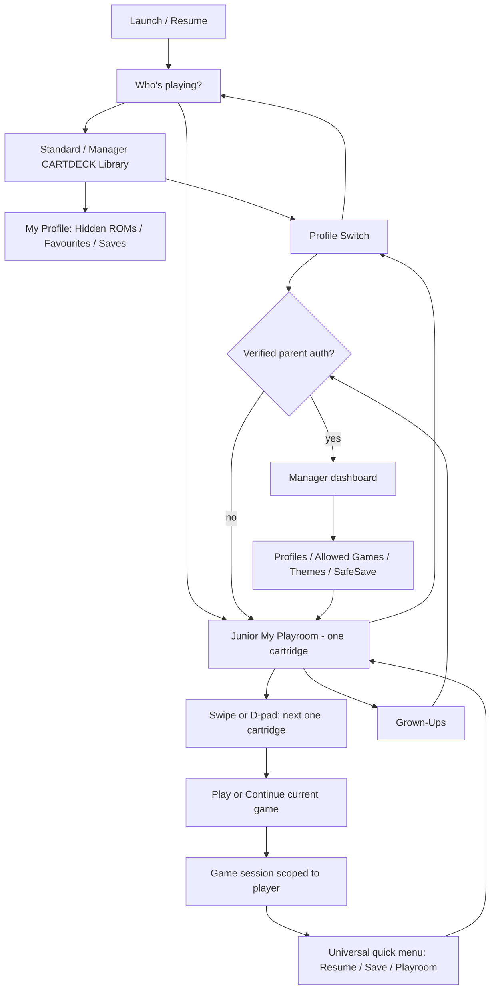

# CARTDECK Junior — Final Screen, Profile Switch and Parental UX Contract
**Sienna Vale + Daniel Mercer, 2026-11-16 · JR-01A detailed design lock**  
**Status:** Ready for technical translation; visual and hardware acceptance pending. Controlling after JR-01 Amendment 1. Does not change standard adult cartridge shelf.

## 1. Naming & surfaces
- Product: **CARTDECK Junior**; child home: **My Playroom**; player selector: **Who's playing?**; parent's restricted management: **Grown-Ups**; backup service: **SafeSave**; future cloud: **SafeSave Vault**.
- Root experience: console-like chooser for any number of local players (test 3 minimum), with Manager/Standard/Junior privileges, NOT three separate installations.
- Junior's primary experience shows **exactly one cartridge cover at a time**, and no secondary row, peek cover, grid or shelf of cover thumbnails in ANY orientation. Child-facing Favourites/Collections/Continue likewise use single-cover layout.
- Theme choices: Standard CARTDECK, Candy Garden, Dino Adventure, Space Explorer, Ocean Friends. Child may choose among explicitly permitted themes; none is gender-specific; production illustration must be original/licensed.

## 2. State and screen routes

Route caveat: selecting another Junior from Junior may be allowed only under a verified manager rule, default parent-auth for **all exits** from the restricted session, including chooser. Returning from OS settings/Android Home is not kiosk-level enforcement; do not promise OS-wide lockout.

## 3. Player chooser UX contract
- Profile avatar + short nickname, selected outline and status (Junior icon only, no unnecessary public age label); **Add Player** only reachable through manager authorization.
- First upgrade without profiles creates non-destructive **Owner / Manager** wrapper around existing library/saves without relocating data; chooser opt-in can be controlled by manager to avoid altering legacy startup abruptly. After enabled, chooser is entry on cold start; an optionally remembered Junior can launch in Junior only, never auto-unlock Manager.
- Profile switches always require quiescing/closing active engine and binding next profile before a new launch. Manager to Standard no PIN if allowed, Junior to unrestricted requires parent gate. Canceled/failed auth returns to Junior, never slips to adult library.

## 4. Junior single-cover interactions
Primary frame: small avatar/name at top; theme background behind card; **ONE** correctly proportioned cartridge/box artwork occupying meaningful focus; short title if needed; prominent `Play` or `Continue` action; optional favourite heart; small discreet locked `Grown-Ups` glyph.
- Swipe left/right one title per completed gesture; D-pad left/right = one title per key press (repeat may accelerate only after controlled long-hold), optional shoulder navigation; focus return stable after launch, rotation, controller reconnect.
- No child-facing app search that can discover disallowed titles. Personal Collections, when switched, are still single-card views and show only parent-approved games. No title sorting/config controls exposed in Junior.
- Zero games: 'Ask a grown-up to add your games' and lock; one game: no inert next arrows; large libraries: parent-configured category selector, 1-by-1 traversal within it; wrap-around behavior constant within chosen group, with optional haptic/visual cue.
- `Play` launches selected title directly if no profile save; `Continue` only if verified valid profile-owned progress. `Start Again` as explicit protected choice only when it would overwrite progress; never a one-tap wipe.
- Game metadata absent: fallback branded cartridge; unapproved/removed/changed identity: no preview, skip current selection with harmless message; missing engine: ‘This game needs a grown-up’ no technical traceback; still no access to file picker.
- One-cartridge requirement applies portrait, landscape, tablet, TV including a 6-year-old's use. Visual design retains existing authentic cartridge aspect/corners; no game art crop and no screen-top bleed.

## 5. Layout-specific measurable design values (dp are Android layout units, not fixed pixels)
| Surface | Composition | Input | Constraints |
|---|---|---|---|
| Portrait handheld (compact) | Centred single card with max height ~50-60% available body; Play below; avatar/lock above; minimise scroll | swipe, touch, on-screen controller outside menu | >=48dp targets, primary >=56dp, text short, dynamic font scaling |
| Landscape handheld | Single dominant cover left/centre, Play at right/below depending height, thin non-obstructing header | thumb swipe, physical D-pad/confirm/back | no separate cover row; game artwork never hidden by controls / cutouts |
| Tablet portrait/landscape | Same single-cover hierarchy in generous two-area composition, no extra cartridge columns | touch or controller | artwork responsive cap to avoid gigantic cover, category switcher clear |
| TV / 10-foot | One focused cover in safe central region, label and Play large; 5% overscan/safe area around edges | D-pad, A/confirm, B/back, universal menu, optional shoulders | >=5% safe margins, focus ring high contrast, no touchscreen or keyboard dependency |

Respect TalkBack/accessibility focus order avatar > cartridge/title > prev/next > Play > favourite > Grown-Ups. Reduced motion/high contrast; no sound-only feedback. Focus does not wrap unexpectedly into restricted controls.

## 6. Grown-Ups management — primary product feature
Entry: always reachable from Junior behind PIN/device-backed manager verification, and from Manager in standard library.
```
Grown-Ups
  Players
    Create / edit nickname/avatar/type
    Set Manager/Standard/Junior (Junior→Standard restricted, not child-accessible)
    Set parent recovery
    Archive/delete profile with save retention/export choice
  Junior Game Access
    Approve/remove cartridges (canonical IDs), per Junior
    Optional themed groups (Pets, Barbie, Adventures...)
    View unrated/unknown game metadata as unknown, not 'safe'
    Preview Playroom without bypassing launch policy
  Playroom Personalisation
    Allowed themes/avatar controls, reduced motion, accessibility
  SafeSave
    Export current player / all players, memory cards, import, transfer, recovery
  System / Help
    Access model and limitations, recover manager access safely
```
- Manager permissions apply at service/repository/launcher/save layer and on deep links, not merely Compose screens. Parent gate before other profiles' data or ROM admin. Use secure verifier with rate-limited attempts and a verified recovery method (device owner credential or pre-established recovery secret); do not invent PIN bypass.
- Standard player can hide titles and use a personal collection; hidden titles do not delete shared ROM, memory cards or other players' games. Manager may enforce restrictions on Standard only through distinct permission grant—no hidden filter accidentally turned into allowlist.
- Parents can manage Junior's saves without unlocking the child's restrictions. Importing an orphaned save never auto-approves a ROM or changes game access.

## 7. Save Centre / SafeSave screen contract
`SafeSave → Selected Player (own or authorised) → Export Everything / Export Game / Memory Cards / Import / Transfer / Recovery`.
Every export screen shows:
`[N] supported verified artifacts`, `[N] detected unverified`, `[N] excluded`, `[N] active/locked`, total estimated bytes, consoles included, memory-card group count. A save archive's completion badge is **'Complete for verified supported items'**, not unqualified 'All saves saved' if omissions remain.
Before export: show player scope; for multi-player manager archive require confirmed authorization and privacy warning.
Restore conflict screen shows `Existing target progress`, `Incoming snapshot/version`, destination player and game, compatibility; choices Skip / New slot where supported / Replace after backup. No default destructive choice.
SafeSave Vault entry visually labelled **Future / Optional** until backend implemented, audited and accepted; never render actionable Connect/Upload until available.

## 8. Game universal menu and hardware contract
- Child in-game menu: Resume; Save Progress (only when supported, no fake success); Return to My Playroom; contextual parent help if game/core fails. Existing controller menu trigger from GC-01 preserved; no new conflicting key chord. TV D-pad focus never trapped or assumes touchscreen.
- Non-Junior game menu remains unchanged unless separately approved. Junior switching closes game's runtime safely; session ownership binds before writes; no profile switch from game overlay without close/flush.
- Different engines may expose different save capabilities; UI must use actual adapter capability reporting.

## 9. Error/empty/privacy states
No approved cartridges; orphaned save; ROM moved; missing emulator; old save ambiguous; blocked parent auth; child accidentally hits system Back; offline; insufficient storage; export to SAF provider failed; corrupt import; active engine cannot flush; incompatible state version; manager PIN lost; profile archived; appearance invalid. Each returns to previously safe context with no data loss and plain-language instruction. Child never sees actual absolute paths, secret keys, backend URLs, stack traces or unrelated gamer identities.

## 10. Design acceptance (Sienna to Marcus)
- Exactly one visible cover per Junior page (including Favourites/collection page), on each device category.
- No fewer than 3 profiles, selectable and truly distinct progress, all names/avatars/themes retained.
- Manager restriction on Junior enforced at launch not only browse, including deep-link/recent/native path negative tests.
- Standard per-profile hide works with other profiles seeing same shared ROM.
- SafeSave completeness and failure states show honest counts; memory cards identifiable separately.
- All children’s routes and parental workflows usable via touch and controller/TV without unreadable tiny text, hidden buttons or trapped focus.
- Production art and accessibility accepted with actual hardware screenshot/talkback review. Concept art is not source implementation proof.
